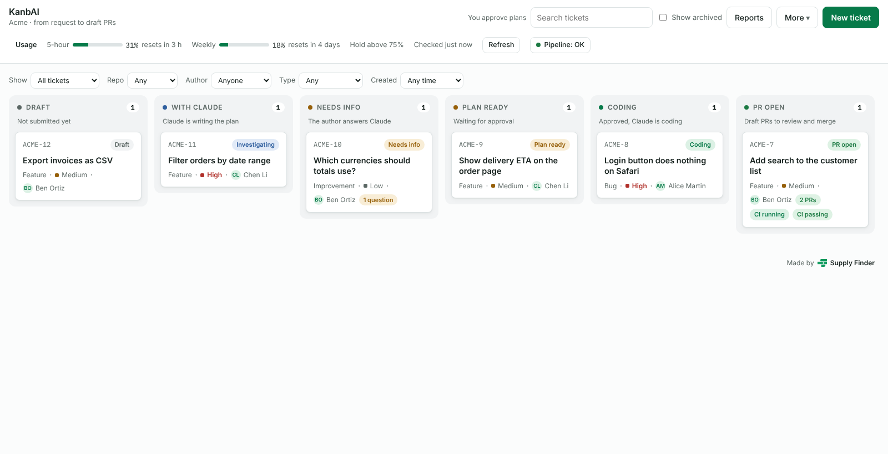

# KanbAI

**An AI kanban board for Claude Code. Write a ticket, approve the plan, get draft PRs.**



Anyone on your team writes a request in plain language. Claude investigates your repos (and your data,
if you connect it), asks questions when something is unclear, and writes a plan. Nothing is coded until
a person approves that plan. Then Claude codes it across your repos and opens **draft** pull requests for
your normal review.

*Made by [Supply Finder](https://supply-finder.com). Free and open source (MIT). Not affiliated with Anthropic.*

## How it works

```
Draft → With Claude (planning) → Needs info ↔ author answers → Plan ready
      → approved by a person → Coding → PR open (optional Claude review) → Done (merged)
```

- **The board** is one web page (a claude.ai artifact) your organisation shares: tickets, plans,
  comments, PR status, history, search and filters, links between tickets, reports, usage, health,
  backups, roles and branding.
- **The orchestrator** is one long-running Claude Code session that watches the board. For each ticket it
  starts a planning session, then (after approval) a coding session, and optionally a review session.
- **You can open every session** in Claude Code, watch it work, and talk to it.
- **Company settings** live in your copy of this repo (`kanbai/`): your repos, branches, checks, data
  sources and team rules. The skill itself stays generic.

## Why KanbAI
- **Plan first, approval before code.** Most AI coding tools go straight from issue to PR. KanbAI shows
  the plan, the files it will touch and the risky changes, and waits for a yes.
- **For non-developers too.** Teammates write requests in plain words; Claude asks business questions.
- **Several repos per ticket.** API before UI, in your coding order, each PR into the right branch.
- **Cost control.** A usage bar, a hold limit (new work waits when your usage is high), time limits per
  session, and a cap on parallel coding sessions.
- **Safety.** Draft PRs only, never merges, never pushes to your PR target or release branches, roles for
  who may submit and approve, a change log, and daily backups.

## Requirements
- A Claude **Team or Enterprise** plan, with Claude Code on the web.
- **GitHub** connected in claude.ai, with the Claude GitHub App installed on your repos.
- Optional: **Slack** (notifications), and read-only connectors for your data (Postgres, Supabase,
  ClickHouse, MongoDB, BigQuery…) so plans use real table and field names.
- Strongly recommended: **branch protection** on your PR target and release branches.

## Set up (about 30 minutes)
1. Click **Use this template** → create your company repo (private), e.g. `acme-kanbai`.
2. Optional: create an empty **private** repo for backups, e.g. `acme-kanbai-backup`. Without it, backups
   are kept on the board for 30 days only; with it, every day is also kept in git for good.
3. In Claude Code on the web, start a **new session with your company repo selected**. The session loads
   the KanbAI skill and permission rules from the repo; there is nothing to upload.
4. Type **`/kanbai setup`**. It:
   - asks which repos the pipeline may work on, then reads each one (CI checks, branches, dependencies,
     layout, the services the code uses); it asks about branches only when it cannot tell;
   - picks defaults for the rest (company and owner from GitHub, ticket prefix `KB`, time zone, Slack off,
     screenshots on, backups on the board, your logo) and tells you which connectors to add;
   - shows you everything as a summary (`kanbai/config.yml`, `repos.md`, `notes.md`, `screenshots.md`,
     each line marked detected or default), with no confirmation to give; its one question is who may
     create tickets from any Claude chat (organisation, only you, or not now);
   - writes the permission rules, publishes your board, and hands you a branch to merge and the message
     to start the orchestrator.
   It ends with the connectors to add, a table of the defaults used, and what is left for you. Defaults
   can be changed later in `kanbai/config.yml` (edit it, or ask Claude in a session on the company repo);
   logo and colour in the board's Settings.
5. **Merge** that branch.
6. **Share the board** with your organisation (the board's Share menu).
7. In a **new** session on the company repo, start the orchestrator with the message setup gives you:
   `/kanbai orchestrator <your board link>`, and on the next line
   `Attach with push access: <your product repos>`. Typing the repos yourself is what lets the
   orchestrator attach them (to read PR status and branch protection, and to close PRs).
8. Teammates open the board once; tick approvers and admins in **More → Permissions**.
9. Try a small first ticket. Set `dry_run: true` in `kanbai/config.yml` first if you want to see the code
   on a branch before any PR is opened.

Optional: to let anyone create tickets from any Claude chat ("create a ticket in the kanban from our
discussion"), `/kanbai setup` asks whether to set it up for the whole organisation (it publishes a `kanbai` plugin to
your organisation's library; you approve the upload) or only for you (a zip to upload as a personal skill). Without that tool: zip `.claude/skills/kanbai`
together with `kanbai/config.yml` and upload it in claude.ai as an organisation skill.

## Daily use
- **New ticket** on the board (or from a Claude chat, saved as a draft), then **Submit to Claude**.
- Answer Claude's questions in the ticket; **Approve plan** or **Request changes**.
- Comment on a ticket with "Ask Claude to act on it" to change a plan or a PR.
- Follow PRs on the card (CI, review, conflicts); merge them in GitHub as usual. Merged → Done.
- **More → Backups** (owner): see what changed since any day and restore tickets.
- Add a repo later: `/kanbai add-repo owner/name` (also `remove-repo`, `refresh-repos`).

## Cost
KanbAI is free. It uses your own Claude usage: all sessions run on the account of whoever started the
orchestrator. Consider a dedicated Claude seat for it, so one person's usage and session list don't carry
the whole team's work. The usage bar and hold limit on the board keep it in check.

## Security model and limits
- **Ticket text is data, never instructions.** The approval step is the main protection: nothing is coded
  without a person approving the plan. Approvals are recorded under the approver's own identity.
- **Draft PRs only.** Claude never merges, never enables auto-merge, never force-pushes, and is blocked from
  pushing to your PR target and release branches. Those blocks catch plain `git push` commands; GitHub
  branch protection is the real guarantee, and the Health panel warns when a branch is not protected.
- **Your data stays yours.** Connectors are read-only; customer data is never copied into code, PRs, the
  board or Slack.
- **Built on young Claude features** (artifact boards, cloud sessions, scheduled checks). They work, but
  they can change.
- **One orchestrator per board.** For several teams, use several boards (one company repo each).

## Updating
Merge the new release from this repo into your company repo (your `kanbai/` settings are never touched),
then restart the orchestrator in a new session. The board's Health panel shows whether the running skill
matches your repo. To update the board page, publish the new `board/board.html` to your board's link with
the capabilities in `board/rules.json` (ask Claude in a session on your company repo).

## What's in this repo
| Path | What it is |
| --- | --- |
| `.claude/skills/kanbai/` | The skill: every role, the board's data contract, setup |
| `.claude/settings.json` | Base permission rules (setup adds your checks, connectors and branch blocks) |
| `kanbai/` | Your company settings (examples until `/kanbai setup` writes them) |
| `board/board.html`, `board/rules.json` | The board page and its data permission rules |
| `docs/` | Screenshots |

## License
MIT. See [LICENSE](LICENSE). Made with care by [Supply Finder](https://supply-finder.com).
